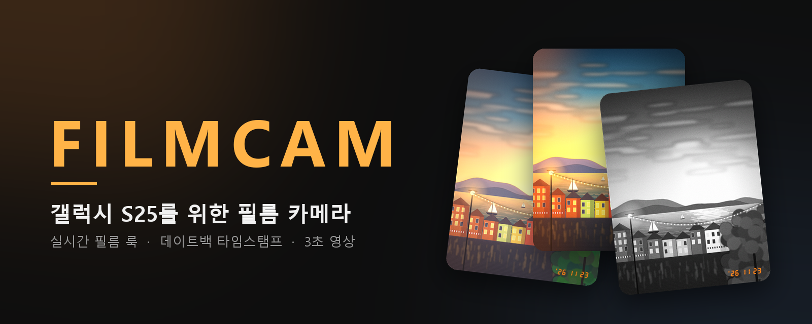
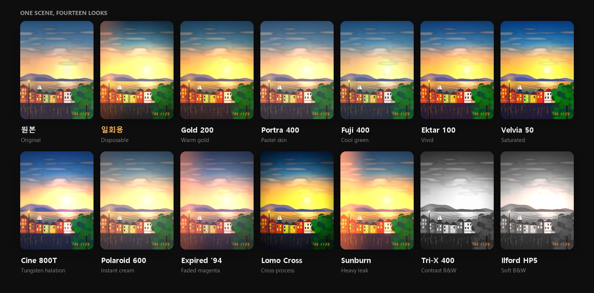
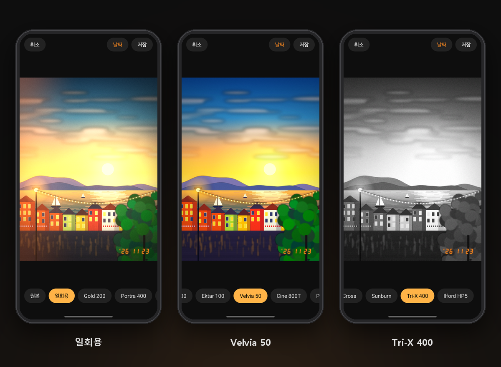

<p align="center">
  
</p>

<p align="center">
  
  
  
  
</p>

<p align="center">
  <a href="#features">Features</a> &nbsp;·&nbsp;
  <a href="#film-looks">Film Looks</a> &nbsp;·&nbsp;
  <a href="#screens">Screens</a> &nbsp;·&nbsp;
  <a href="#how-it-works">How it works</a> &nbsp;·&nbsp;
  <a href="#getting-started">Getting started</a>
</p>

---

FilmCam은 갤럭시 S25에서 쓰려고 만든 필름 카메라 앱입니다.
촬영 화면에서 필름 룩이 실시간으로 보이고, 사진과 영상, 앨범에 있는 기존 사진까지 같은 색으로 처리합니다.
필름 카메라의 데이트백처럼 주황색 날짜를 사진 모서리에 새깁니다.

## Features

| | |
|---|---|
| **실시간 필름 룩** | 촬영 화면에서 바로 필름 효과가 적용된 모습을 보며 찍습니다. 필름 13종을 내장하고, 기본값은 일회용 카메라입니다. |
| **데이트백 타임스탬프** | 주황색 7세그먼트 숫자(`'26 11 23`)를 사진, 영상, 앨범 사진에 새깁니다. 끔, 날짜, 날짜와 시간 중에서 고릅니다. |
| **3초 영상** | 셔터를 한 번 누르면 3초 뒤 자동으로 멈춥니다. 필터와 타임스탬프가 영상에 들어가고 소리도 함께 녹음됩니다. |
| **앨범 사진에 필름 입히기** | 갤러리 사진을 불러와 필름을 바꿔 보고 저장합니다. 사진의 촬영일을 타임스탬프 날짜로 씁니다. 갤러리의 공유 메뉴에서 FilmCam으로 바로 보낼 수도 있습니다. |
| **가로와 세로 촬영** | 폰을 돌리면 화면이 따라 돌고, 타임스탬프는 사진을 바로 세웠을 때 항상 오른쪽 아래에 찍힙니다. |
| **전면 카메라** | 셀카를 지원합니다. 미리보기와 저장 결과의 방향이 같습니다. |

## Film Looks

<p align="center">
  
</p>

| 필름 | 성격 |
|---|---|
| **일회용** | 노란 기운과 강한 비네팅, 한쪽으로 새는 빛 |
| **Gold 200** | 따뜻하고 포근한 골드 톤 |
| **Portra 400** | 부드러운 파스텔, 피부색이 고운 색감 |
| **Fuji 400** | 시원한 초록과 청록 기운 |
| **Ektar 100** | 쨍하고 선명한 풍경용 색감 |
| **Velvia 50** | 아주 진한 채도와 강한 대비 |
| **Cine 800T** | 청록 그림자, 밝은 곳에서 번지는 붉은 할레이션 |
| **Polaroid 600** | 크림빛으로 바랜 검정, 포근한 인스턴트 사진 |
| **Expired '94** | 유통기한이 지난 필름 같은 마젠타 틴트와 빛샘 |
| **Lomo Cross** | 크로스 프로세스. 푸른 그림자와 노란 하이라이트 |
| **Sunburn** | 한쪽에서 번지는 강한 주황 빛샘 |
| **Tri-X 400** | 거친 입자의 고대비 흑백 |
| **Ilford HP5** | 부드러운 흑백 |

각 필름은 색 보정, 그림자와 밝은 곳의 색 틴트, 입자, 비네팅, 빛샘, 할레이션을 조합한 값입니다.
룩을 고치거나 새로 만들려면 [`Filters.kt`](app/src/main/java/com/filmcam/Filters.kt)의 숫자만 바꾸면 됩니다.

## Screens

<p align="center">
  
</p>

앨범 사진 편집 화면입니다. 아래 줄에서 필름을 고르고, 날짜 버튼으로 타임스탬프를 켜고 끈 뒤 저장합니다.
이 문서의 이미지는 직접 그린 일러스트 샘플에 앱이 실제로 처리한 결과입니다.

## How it works

```
CameraX Preview     ──▶ SurfaceTexture ──▶  OpenGL ES 3.0 셰이더 ──┬──▶ 미리보기 (TextureView)
                                            필름 룩 + 타임스탬프   └──▶ MediaRecorder (3초 영상)

CameraX ImageCapture ──▶ 같은 셰이더 (오프스크린) ──▶ JPEG 저장
앨범 사진            ──▶ 같은 셰이더 (오프스크린) ──▶ JPEG 저장
```

미리보기, 영상, 사진, 앨범 편집이 하나의 셰이더를 공유하기 때문에 어느 경로로 찍어도 같은 색이 나옵니다.

| 파일 | 역할 |
|---|---|
| [`MainActivity.kt`](app/src/main/java/com/filmcam/MainActivity.kt) | 화면 구성, 촬영과 녹화 흐름, 앨범 편집 |
| [`CameraRenderer.kt`](app/src/main/java/com/filmcam/CameraRenderer.kt) | GL 스레드, 카메라 프레임 렌더링, 3초 영상 녹화 |
| [`GlCore.kt`](app/src/main/java/com/filmcam/GlCore.kt) | EGL, 필름 셰이더, 오프스크린 필터 처리 |
| [`Filters.kt`](app/src/main/java/com/filmcam/Filters.kt) | 필름 파라미터 |
| [`DateStamp.kt`](app/src/main/java/com/filmcam/DateStamp.kt) | 7세그먼트 날짜 숫자 그리기 |
| [`Views.kt`](app/src/main/java/com/filmcam/Views.kt) | 가로와 세로 레이아웃, 셔터 버튼, 필름 선택줄 |
| [`MediaSaver.kt`](app/src/main/java/com/filmcam/MediaSaver.kt) | 갤러리에 저장 |

## Getting started

**필요한 것**: JDK 21, Android SDK (플랫폼 36)

```bash
# Windows
gradlew.bat assembleDebug

# macOS / Linux
./gradlew assembleDebug
```

결과 파일은 `app/build/outputs/apk/debug/app-debug.apk` 입니다. 폰에서 USB 디버깅이나 무선 디버깅을 켠 뒤 설치합니다.

```bash
adb install -r app/build/outputs/apk/debug/app-debug.apk
```

> **프로젝트 경로에 한글이 있으면** Android Gradle Plugin이 빌드에 실패합니다.
> 영문 경로로 옮기거나, Windows에서는 `subst F: "<프로젝트 폴더>"`로 드라이브를 연결한 뒤 `F:\`에서 빌드하세요.

## Compatibility

- 갤럭시 S25에서 개발하고 확인했습니다. 다른 기기는 확인하지 않았습니다.
- Android 10 (API 29) 이상
- 요청하는 권한은 카메라와 마이크(3초 영상 녹음용)뿐입니다. 저장소 권한은 쓰지 않고, 앨범은 시스템 사진 선택기로 불러옵니다.
- 결과물은 `Pictures/FilmCam`, `Movies/FilmCam`에 저장됩니다.
- 인터넷을 사용하지 않습니다.

## Limitations

- 개인용으로 만든 앱이라 후면 카메라 기본 렌즈와 전면 카메라만 지원합니다. 줌과 렌즈 전환은 없습니다.
- 필름 색감은 수치로 재현한 것이어서 실제 필름 스캔과 똑같지는 않습니다.
- 디버그 키로 서명되어 있어 스토어 배포용이 아닙니다.

## License

[MIT](LICENSE)
